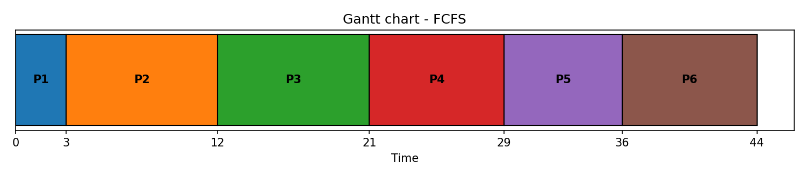
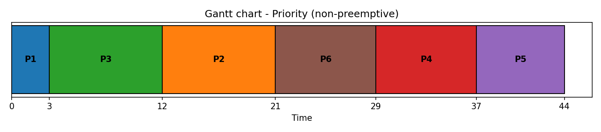

# محاكي جدولة المعالج (FCFS و Priority)

مشروع مادة **نظم التشغيل 1 (العملي)** — مجموعة **GRJW**

## أعضاء المجموعة

| الاسم الكامل | الرقم الجامعي |
|---|---|
| (أسماء محمد الإدريس) | ( 111123007) |
| (منار عارف الحسين) | (111122027) |
| (نور عماد معو) | (111223408) |

## فكرة المشروع

برنامج بلغة **Python** يقرأ العمليات من ملف `input.txt` ويجدولها بخوارزميتين:

1. **FCFS**: من يصل أولاً يُنفَّذ أولاً (بدون مقاطعة).
2. **Priority (بدون مقاطعة)**: تُنفَّذ العملية الأهم (الرقم الأصغر) من العمليات التي وصلت.

ثم يرسم مخطط Gantt، ويحسب أزمنة **الانتظار** و**الدوران** و**الاستجابة**، ويقارن بين الخوارزميتين.

## طريقة التشغيل

```
pip install matplotlib
python scheduler.py input.txt
```

الناتج: جداول في الشاشة، وصورتان: `gantt_fcfs.png` و `gantt_priority.png`.

## ملف الإدخال

```
# name arrival burst priority
P1 0 3 1
P2 0 9 2
P3 1 9 1
P4 4 8 5
P5 4 7 5
P6 4 8 3
```

كل سطر: الاسم، زمن الوصول، زمن التنفيذ، الأولوية. الأولوية: **الرقم الأصغر هو الأهم**.

## قواعد حسم التعادل

- في FCFS: الأسبق وصولاً، ثم الأصغر رقماً.
- في Priority: الأصغر أولوية، ثم الأسبق وصولاً، ثم الأصغر رقماً (مثال: P4 قبل P5).

## القوانين المستخدمة

- **الدوران** = زمن الانتهاء − زمن الوصول
- **الانتظار** = الدوران − زمن التنفيذ
- **الاستجابة** = زمن أول تشغيل − زمن الوصول

## النتائج

### FCFS



| العملية | الانتظار | الدوران | الاستجابة |
|---|---|---|---|
| P1 | 0 | 3 | 0 |
| P2 | 3 | 12 | 3 |
| P3 | 11 | 20 | 11 |
| P4 | 17 | 25 | 17 |
| P5 | 25 | 32 | 25 |
| P6 | 32 | 40 | 32 |
| **المتوسط** | **14.67** | **22.00** | **14.67** |

### Priority (بدون مقاطعة)



| العملية | الانتظار | الدوران | الاستجابة |
|---|---|---|---|
| P1 | 0 | 3 | 0 |
| P2 | 12 | 21 | 12 |
| P3 | 2 | 11 | 2 |
| P4 | 25 | 33 | 25 |
| P5 | 33 | 40 | 33 |
| P6 | 17 | 25 | 17 |
| **المتوسط** | **14.83** | **22.17** | **14.83** |

## المقارنة

| المقياس (المتوسط) | FCFS | Priority |
|---|---|---|
| الانتظار | **14.67** | 14.83 |
| الدوران | **22.00** | 22.17 |
| الاستجابة | **14.67** | 14.83 |

**الملاحظات:**

1. الفرق في المتوسطات صغير جداً (0.16 فقط). سبب ذلك أن الخوارزميتين **بدون مقاطعة** وكل العمليات تنتهي عند الزمن 44 في الحالتين، فمجموع الأزمنة يتغير قليلاً فقط.
2. الفرق الحقيقي يظهر **بين العمليات**: في Priority انخفض انتظار P3 من 11 إلى 2 وانتظار P6 من 32 إلى 17 لأن أولويتيهما أعلى. وفي المقابل زاد انتظار P2 من 3 إلى 12، وP4 من 17 إلى 25، وP5 من 25 إلى 33.
3. P4 و P5 أولويتهما 5 (الأقل أهمية)، لذلك تنتظران أطول وقت في Priority. وهذا يوضح خطر **الحرمان (Starvation)**: العملية قليلة الأهمية قد تنتظر طويلاً إذا بقيت تصل عمليات أهم منها.
4. في FCFS تظهر مشكلة **تأثير القافلة (Convoy Effect)**: P2 (زمن تنفيذها 9) تؤخر P3 رغم أن أولوية P3 أعلى.

## الخلاصة

- **FCFS** أبسط وأعدل من حيث الترتيب، ومتوسطاتها أفضل قليلاً في هذه البيانات.
- **Priority** أنسب عندما تكون هناك عمليات مهمة يجب خدمتها أولاً، لكن على حساب العمليات الأقل أهمية.
- لو كانت الخوارزمية **مع مقاطعة** لتغيرت النتائج، فالعملية الأهم كانت ستأخذ المعالج فور وصولها.

## ملفات المشروع

| الملف | الوصف |
|---|---|
| `scheduler.py` | البرنامج الرئيسي |
| `input.txt` | بيانات العمليات الخاصة بالمجموعة |
| `gantt_fcfs.png` | مخطط Gantt لـ FCFS |
| `gantt_priority.png` | مخطط Gantt لـ Priority |
